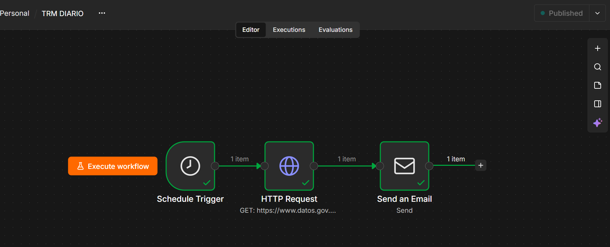
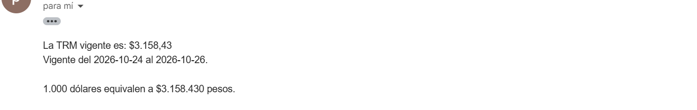

# TRM diaria desde una API pública

Flujo de n8n que consulta cada mañana la Tasa Representativa del Mercado (TRM) en la API de datos abiertos del Gobierno de Colombia y la envía por correo, con el valor en formato colombiano y una conversión de referencia.



---

## Problema

La TRM cambia cada día hábil y se usa para convertir facturas, pagos y saldos en dólares. Consultarla a mano todos los días es una tarea pequeña, repetitiva y fácil de olvidar. Es justo el tipo de tarea que conviene automatizar.

## El flujo

```
[Programación 8:00] → [HTTP Request: API de la TRM] → [Correo]
```

| Nodo | Qué hace |
|---|---|
| **Schedule Trigger** | Dispara el flujo cada día a las 8:00, zona horaria `America/Bogota` |
| **HTTP Request** | Hace una petición `GET` a la API de datos abiertos y trae la TRM más reciente |
| **Send Email** | Envía el valor, su vigencia y una conversión de referencia |

La petición:

```
GET https://www.datos.gov.co/resource/32sa-8pi3.json?$limit=1&$order=vigenciadesde DESC
```

| Parte | Qué significa |
|---|---|
| `/resource/32sa-8pi3.json` | El conjunto de datos de la TRM |
| `$limit=1` | Trae un solo registro |
| `$order=vigenciadesde DESC` | Del más reciente al más antiguo |

La API es pública y no requiere clave.

La respuesta:

```json
[{ "valor": "3158.43", "unidad": "COP",
   "vigenciadesde": "2026-10-24T00:00:00.000",
   "vigenciahasta": "2026-10-26T00:00:00.000" }]
```



## Lo que aprendí: el valor llega como texto

En la respuesta, `valor` viene **entre comillas**: es un texto, no un número. Al probar una suma, el resultado fue este:

```
{{ $json.valor + 100 }}   →   "3158.43100"
```

n8n no sumó: **pegó** el 100 al final del texto, sin ningún error. Un resultado así se ve como un número y es completamente falso.

La solución es convertirlo antes de operar:

```
{{ Number($json.valor) * 1000 }}
```

> Antes de calcular con datos de una API, hay que revisar su tipo. Un número guardado como texto no avisa: devuelve un resultado equivocado que parece correcto.

## Decisiones de diseño

**Se consulta cada día, no se guarda el valor.** La TRM de un viernes cubre también el sábado y el domingo, y la API lo indica con los campos `vigenciadesde` y `vigenciahasta`. El correo muestra ese rango para que no haya dudas sobre qué días aplica.

**Formato colombiano.** `toLocaleString('es-CO')` escribe el valor con punto de miles y coma decimal: `$3.158,43`. Las fechas se recortan con `.slice(0, 10)` para quitar la hora.

**Zona horaria explícita.** Por defecto, n8n usa la zona de Nueva York. Sin configurarla, las 8:00 del flujo serían las 7:00 en Bogotá.

## Limitaciones

- **Solo se ejecuta mientras n8n esté corriendo.** En local, eso significa con el equipo encendido. En producción se instala en un servidor que está activo todo el día.
- **No maneja fallas de la API.** Si el servicio no responde, el correo no se envía y nadie se entera. El siguiente paso sería un aviso de error.
- **No guarda historial.** Escribir cada TRM en una tabla permitiría analizar su evolución.

## Reproducir

1. Instalar n8n: `npx n8n`
2. Importar `trm-diaria.json` desde el menú del editor
3. Configurar la credencial SMTP para el envío del correo
4. En la configuración del flujo, elegir la zona horaria `America/Bogota`
5. Publicar el flujo

## Herramientas

n8n · API REST · JSON · expresiones JavaScript
